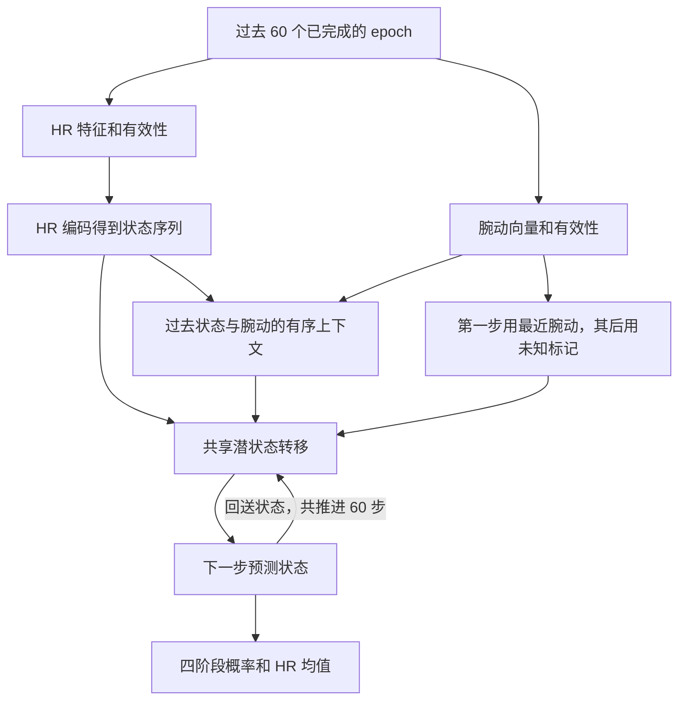

# Wearable Sleep World Model 首轮实现与实验

| 项目 | 约定 |
| --- | --- |
| 任务 | 实现腕动条件潜状态 rollout，做四阶段预测及同信息对照 |
| 起点 | `main` at `e3f5264e2ed0efcc3ca9e04e86ae1503bf5de44d` |
| 状态 | 用户选定本轮方向。供 HPG Codex 接手实现和运行，结果待回传 |
| 依据 | 2026-11-12 组会 slides 第 5 页，[PatientWM v1](https://arxiv.org/abs/2610.17059v1) §3，[BIDSleep 1.0.1](https://physionet.org/content/bidsleep-dataset/1.0.1/) |
| 历史证据 | [六夜 pilot](../reports/2026-10-29_pilot/report.md) `diagnostic_20261029T123226911439Z`，[38 夜扩展](../reports/2026-10-29_expanded/report.md) `expanded_seed40_12t7v2n` |

## 1. 本轮要回答的问题

给定过去 30 分钟的 Apple Watch HR 和腕部加速度，预测接下来 60 个 30 秒 epoch 的 Wake、Light、Deep、REM 概率。预先比较两个问题：同样的历史输入下，递归潜状态预测能否超过直接多步预测？同样都有腕动的情况下，最近一个 epoch 的腕动放进转移函数，能否超过把它放入初始状态？

组会 slides 提出使用从上床到预测原点的整段记录。本轮先用 G3 已有的固定 30 分钟历史、60 步预测和受试者划分，便于检查时序和比较。仓库现有 G3 的诊断目标是未来 Wake 总分钟。六夜 pilot 的 hard duration 解码 MAE 为 1.534 分钟，直接轨迹为 2.541 分钟，恒预测零 Wake 为 0.828 分钟。验证中只有 1 个独立短 Wake 事件。38 夜扩展已完成获取，进展停在时间戳顺序审核。四阶段预测是本轮主任务，Wake 总分钟和短 Wake 作为与 G3 衔接的诊断指标。

## 2. World model 在这里需要什么

| 部件 | 必要性 | 本项目对应 |
| --- | --- | --- |
| 可用观测及截止时间 | 从部分观测估计状态所需 | 原点以前的 HR、加速度及有效性标记。腕端数据决定可用输入 |
| 当前预测状态 | 供转移反复使用的内部表示 | $z_t$ 从历史 HR 得到。状态向量承载预测信息，四阶段是其可读出量 |
| 可递归转移 | 将状态推进到未来，并能把预测的状态送回同一转移 | $\hat z_{j+1}=F_\theta(\hat z_j,c_t,u_j,h/60)$，共享参数，推进 60 步 |
| Action 接口 | 对显式 action-conditioned 转移必需 | $a_t$ 是最新已完成 epoch 的**观测腕动向量**，作为第一步的独立条件。后续步使用未知标记与已观测历史 |
| 预测读出和学习信号 | 把状态的预测能力连到可检验目标 | 共享四阶段读出，外加一个 HR 均值辅助读出。用训练数据的未来目标监督递归预测 |

经典 [Ha & Schmidhuber, *World Models*](https://worldmodels.github.io/) 用观测编码和 $p(z_{t+1}\mid z_t,h_t,a_t)$ 在潜空间模拟动作后果。[DreamerV3](https://doi.org/10.1038/s41586-025-08744-2) 还预测奖励和持续标记，由 actor 和 critic 服务于控制。[V-JEPA 2](https://arxiv.org/abs/2506.09985) 先用无动作的视频学习预测表征，再用机器人动作训练 V-JEPA 2-AC 的规划模型。由此，本项目采用的最小预测式定义是**状态估计、可重复使用的状态转移、可检验的预测**。对指定动作做预测或规划时，还需要一个有明确含义和可用时点的 action 接口。奖励、策略、原始传感器重建和大规模预训练各自服务于额外目标。

我们保留 slides 的 action 入口，将其称为 **observed wrist-motion conditioning**。睡眠阶段变化可能先于腕动，动作值也受腕表佩戴和采样影响。此设置估计历史观测条件下的预测关系。要回答指定干预对睡眠的影响，还需要可选择的干预、明确的赋值与执行记录，以及因果识别设计。

## 3. PatientWM 的方法与可迁移部分

| PatientWM v1 | 在本实验中的落点 |
| --- | --- |
| §3.1–3.2 / Eqs. 1–4。将可用的检验、临床事实和波形表示编码成共享预测状态 $z_t$。类型化的读出从状态预测事件、结局或连续指标 | 用过去完成的 HR epoch 编码状态，给可用性传入 mask。由同一预测状态读出四阶段概率和未来 HR 均值 |
| §3.3 / Eqs. 5–6。治疗动作另编码为 $\alpha_t$，保留有序前缀 $(z_s,\alpha_s)$，用当前状态、动作和历史做带门控的残差更新 | 单独编码 $a_t$，用轻量 GRU 压缩先前的状态与腕动对，并用小残差网络推进状态。第一版保存固定的观测历史摘要 |
| §3.3 / Eqs. 7–8。未来观测经 momentum encoder 得到 stop-gradient 的潜状态目标，另有随可用性掩码计算的读出损失 | 首轮用阶段和 HR 的掩码损失直接监督递归状态。比较通过后再考虑 EMA 潜目标与有序历史消融 |
| §3.4 / Eqs. 9–10 和 Appendix A.2。每步复用预测状态并更新顺序上下文，动作由外部逐步提供。动作来自各步边界已记录、仍有效的治疗，未来观测用于监督或评分 | 我们从同一个 cutoff 一次性启动 60 步预测。实测腕动只能提供到 cutoff，第一步用最近已知腕动，余下步骤使用未知 token。固定观测历史持续给转移提供上下文 |

PatientWM 在 MIMIC-III 的 Core-7 消融中报告 full、无动作、无历史的 AUPRC 分别为 0.2227、0.0861、0.0840。该结果支持在本项目里分别检验输入信息、动作入口和递归结构。它的多步实验以 6 小时为一步，最多推进 16 步，每步有可供给的记录动作。组会中的 [NormWear-2](https://arxiv.org/abs/2605.15465) 提供生理信号和干预共同建模的例子。[Song et al.](https://doi.org/10.1109/TBME.2025.3612158) 提供同一设备和队列的整夜 staging 参照。本实验的比较使用同一信息截止和同一预测原点。详见 [PatientWM v1 正文](https://arxiv.org/pdf/2610.17059v1) §3、§4.3–4.4、Appendix A.2。

## 4. 腕部加速度如何生成每个 epoch 的 action

`motion.csv` 给出 `Timestamp,x,y,z`，时间是 Unix 秒，轴值以 `g` 为单位。`hr.csv` 给时间和 bpm。用 `labels.mat` 的 `recStart` 对齐，naive 时间按 `America/New_York` 解析。epoch $j$ 的样本区间为 $[\mathrm{recStart}+30j,\ \mathrm{recStart}+30(j+1))$。同一 epoch 的有效三轴样本记为 $\mathbf r_k=(x_k,y_k,z_k)$，按文件现有时间顺序处理。数据字段与标签编码见 [PhysioNet README](https://physionet.org/content/bidsleep-dataset/1.0.1/README.md)。

1. 对每个有效样本计算大小 $r_k=\|\mathbf r_k\|_2=\sqrt{x_k^2+y_k^2+z_k^2}$。
2. 用两个已有的连续特征表示腕动。`acc_norm_std` 是 $r_k$ 的 epoch 内总体标准差。`acc_diff_rms` 是 $\sqrt{\operatorname{mean}_k\|\mathbf r_k-\mathbf r_{k-1}\|_2^2}$，仅使用同一 epoch 内的连续有效样本对，跨读取块保留必要的前一样本。它的单位仍为 `g`，用途是表征加速度变化幅度。审核时同时记录样本间隔和每 epoch 样本数，便于解释稀疏和不规则采样。
3. 在有至少两个有效样本且有有效样本对时使用连续运动分量 $m_j=[\mathrm{acc\_norm\_std},\mathrm{acc\_diff\_rms}]$。以训练集的有限特征值拟合标准化后，拼接 `log1p(acc_count)` 和连续分量的有效性标记，形成 $a_j$。缺值在标准化空间填 0，标记缺失。有效样本的低活动值带有效标记。后续步的 `future_unknown` 是单独的输入类型。

静置样例 `(0,0,1)g` 重复出现时，模长均值约 1g，两种变化量均为 0。若在它们中间出现 `(0.1,0,1)g`，两个相邻差的大小都为 0.1g，因此 `acc_diff_rms` 为 0.1g。腕表只测佩戴侧腕部，这些特征是身体活动的局部代理。发布说明给出 `g` 单位，重力补偿的状态待核实。当前定义直接使用已有变化特征。Song §II-C.2 的模长定义相同，其整夜 staging 预处理另使用 1 Hz 插值。本轮使用原始时间分箱和历史缺失标记。源码见 [G3 data.py](../experiments/g3/sleep_g3/data.py)，论文见 [Song et al. §II-C](https://pmc.ncbi.nlm.nih.gov/articles/PMC12931632/)。

## 5. 推理结构和时间索引

- $t$ 表示**最后一个已完成**的 epoch，对应 G3 `build_windows` 原点索引 `i=t+1`。在时间边界 $B$ 只读取时间戳小于 $B$ 的观测。输入为 $[t-59,t]$。未来第 $h$ 个 epoch 的预测目标区间为 $[B+30(h-1),B+30h)$。按区间终点，+5、+15、+30 分钟分别是 $h=10,30,60$，数组从 0 开始时为 `9,29,59`。
- HR GRU 以历史的 `hr_mean`、`hr_std`、`log1p(hr_count)` 和 mask 生成 $s_j$。小 GRU 按顺序读取 $(s_j,E_a(a_j))_{j=t-59}^{t-1}$ 得到 $c_t$。状态可加一个轻量初始化层，显式腕动 arm 的 $z_t$ 由 $s_t$ 及空腕动 token 初始化。融合对照把最后一个 $a_t$ 放进同一个初始化层。
- 显式腕动 arm 的第 1 步用 $u_t=E_a(a_t)$。从第 2 步起 $u_j$ 使用 `future_unknown`。固定 $c_t$，以 $v_h=[\hat z_{t+h-1},c_t,u_{t+h-1},h/60]$ 为输入。共享转移从 $\hat z_t=z_t$ 开始，每一步将预测状态送入下一步，两个 head 均读取该状态。
- 训练和验证用同样的 free rollout。未来 `expert_label`、HR 和有效性用于对应 loss/评分。当前参考阶段可训练 persistence 的分类器。所有预测入口只接收过去数据。实测未来腕动一律留在 cutoff 外。

$$
\hat z_{t+h}=\hat z_{t+h-1}+\sigma(g_\theta(v_h))\odot\tanh(d_\theta(v_h)),\qquad
p_{t+h}=\operatorname{softmax}(W_{\mathrm{stage}}\hat z_{t+h}+b_{\mathrm{stage}}).
$$

如果后续要在每一步使用预测的腕动值，可加 $\hat a_{t+h}=D_a(\hat z_{t+h})$。用训练人的未来腕动监督该 head，rollout 下一步接自己的 $\hat a_{t+h}$。以本轮的未知 token 版本作为比较，检验这种联合预测是否有增益。

## 6. HPG 实现顺序与首轮对照

### 数据路径

1. 用 [expanded_protocol.json](../experiments/g3/expanded_protocol.json) 的 seed 40、33/7/7 按人划分和历史覆盖规则。每个原点前 60 个 epoch 中至少 80% 同时有 HR 和 ACC 样本，步幅 10 个 epoch。所有方法比较同一组 `(participant, night, origin)`，包括 HR-only。已结束记录之外或标签 unknown 的目标留 `-1`，评分时 mask。封存测试分区保持封存。
2. 复用 [G3 数据解析、分窗](../experiments/g3/sleep_g3/data.py)、[审核](../experiments/g3/sleep_g3/runner.py) 与已验证的 acquisition receipts。现有 `Episode.wake` 已合并各睡眠阶段，四分类从原始 `expert_label` 读取。原始代码 `0`→Wake、`1/2`→Light、`3`→Deep、`4`→REM、`5`→`-1`。核对形状为 `[N,60,features]` 观测、`[N,60]` 阶段目标和单独存放的未来 HR 目标与 mask。将 stage cache 放到独立外部 run 目录。标准化拟合使用训练人历史 epoch 的有效有限值。
3. 在 [ENVIRONMENT](../docs/ENVIRONMENT.md) 中历史 pilot 的固定 4 train / 2 val × 1 夜上，先验证同样的 6 夜读入、指标和训练路径。38 夜扩展用现有完整 acquisition receipt 和原始文件重新建立独立 stage audit。先按 [timestamp audit](2026-11-12_timestamp_audit.md) 定位疑似首个文件 `Bidslab36/1/motion.csv`，记录时间反转、重复、分块和标签区间影响。原有顺序 guard 保留为扩展运行的前置条件。若审核仍失败，回传诊断及 pilot smoke 结果。修复策略与修复后的 cohort 另作有记录的数据决策。

### 比较矩阵

| 方法 | 相同 forecast origin 可见的信息 | 首轮解释 |
| --- | --- | --- |
| 训练集阶段先验 | 按 lead 估计 train 四类频率。取最高频作 stage 决策 | 无传感器比较 |
| 当前阶段 persistence | 用训练人的历史 HR/ACC 拟合四分类器，重复它估计的当前四阶段分布 | 可部署的 stay-in-current-stage 参照 |
| HR+ACC 直接多步 | 相同历史，输出 60 步，阶段和辅助 HR 同时预测 | 检验递归结构能否超过直接预测 |
| HR-only rollout | HR 历史与已知时间步，所有运动输入槽均掩码 | 与融合 rollout 比较运动历史的增量信息 |
| HR+ACC 融合 rollout | 与显式 arm 同一 $c_t$，最近的 $a_t$ 进入初始化层，转移接收未知 token | 同信息、同递归结构的关键对照 |
| 显式腕动 rollout | 与融合 arm 同一 $c_t$，当前初始化层使用空 token，最近的 $a_t$ 只进入第一步转移 | 检验腕动在转移内显式条件化的收益 |

三个 rollout arm 共用网络骨架和特征规格，各自从头训练。两种 HR+ACC rollout 都可见完整过去 60 个 epoch，相同的历史对 $(s_j,a_j)$ 进入 $c_t$。动作端口和初始化端口的区别限于 $a_t$ 的注入位置。直接多步用同样的状态、腕动历史和最后 epoch 信息，另接一次输出 60 步的头。报告参数量，统一损失、训练数据和起点。需要检查腕动幅值贡献时，用保留 ACC 计数和 mask、将标准化运动幅值置为训练中心值的匹配消融。

### 训练、检查和评分

- 小模型起点为 32 维状态、batch size 64、Adam `1e-3`、固定 15 个训练轮。四阶段用已知标签的 cross-entropy，HR 均值用训练集尺度下的 masked Huber，系数 `0.1`。两项 loss 各按自己的有效目标数归一。单个 batch 某项无目标时跳过该项。先跑一次 seed `0` 的六夜 smoke，扩展审核通过后固定 seeds `0,1,2`，报告各次和均值。全程使用相同输入定义和训练配置。
- 接入 [现有 HPG launcher](../scripts/run_g3.sh) 和可用的 CPU PyTorch 环境，独立 stage 命令与配置。Slurm 内先做合成和六夜 smoke，再做审计通过的固定扩展。建议 smoke `2 CPU / 8 GB / 30 min`，扩展每个 audit 或训练作业 `2 CPU / 8 GB / 2 h`。复用已有数据和环境，记录实际用量。可用环境缺少神经模型依赖时，先交付数据审核、训练集先验和 persistence 结果，报告算力或环境停止点。
- 必查样例包括静置/移动/缺样本的 action，跨 epoch 和 chunk 的相邻样本，刚好在 cutoff 的样本，原始 `0..5` 到四类加 mask 的映射，以及 h=10/30/60 的索引。固定同一 manifest 和历史，改动未来传感器或标签后，原点、历史张量与全部 60 步预测应保持一致。验证预测状态确实回送到下一步，并保留现有 G3 回归检查。
- 主报告在 +5/+15/+30 分钟给四类 macro-F1、各类 F1、Wake recall、混淆矩阵及支持数。+30 分钟作为优先判断点。用每人对该 lead 的有效 origins 构建归一化混淆矩阵，等权平均后计算四类 F1。无参考支持的类和对应四类 macro-F1 标为不可估计，仍给已支持类别结果。报告每个 lead 的 participants、origins 和 unknown 数量。用已知目标报告多分类 NLL、Brier，并给 HR MAE 与最后可用 HR 延续基线。
- 与 G3 的衔接指标是 $0.5\sum_{h=1}^{60}p(\mathrm{Wake}_{t+h})$ 的期望 Wake 分钟、完整标签窗口的 MAE，以及独立短 Wake 事件覆盖。使用 [G3 事件定义与匹配](../experiments/g3/sleep_g3/metrics.py)，阈值固定 `0.5`，报告 1–2 epoch 事件的独立数量、召回和重复覆盖，附训练集 median 与恒零 Wake 分钟对照。重叠窗口的波动以受试者为单位解释。

## 7. 结果交接

主结论先看 `显式腕动 rollout − 融合 rollout` 与 `显式腕动 rollout − 直接多步` 的配对差。首轮诊断看各 lead 的方向是否跨 seed 一致，并同时看 Wake recall、NLL 和支持数。若仅短 lead 有收益，汇报有效时距。若融合有收益而显式端口无收益，保留传感器增益的结论并检查端口或时距。若所有模型接近先验，先查阶段分布、标签覆盖、原点和有效样本，再解释归纳偏置。六夜 smoke 用来检验流程和量级，扩展审核完成后的结果才用于首轮模型比较。

按 [报告模板](../templates/EXPERIMENT_REPORT.md) 写 `reports/<run_id>/report.md`，附聚合指标和配对表，更新 [CURRENT_STATUS.md](../CURRENT_STATUS.md) 与报告索引。记录实际 spec/code SHA、协议、数据和时间戳审核身份、split/coverage、命令、环境、job、运行状态与 HPG artifact 路径。原始文件、逐人预测、权重与完整日志存 HPG。若 38 夜未能评分，明确标记扩展状态并给出可核对的停止位置。
